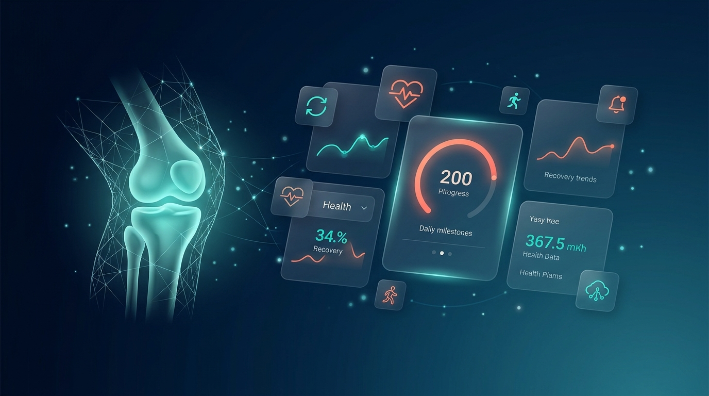
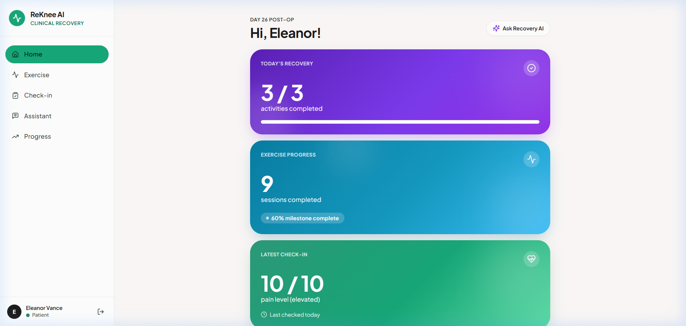
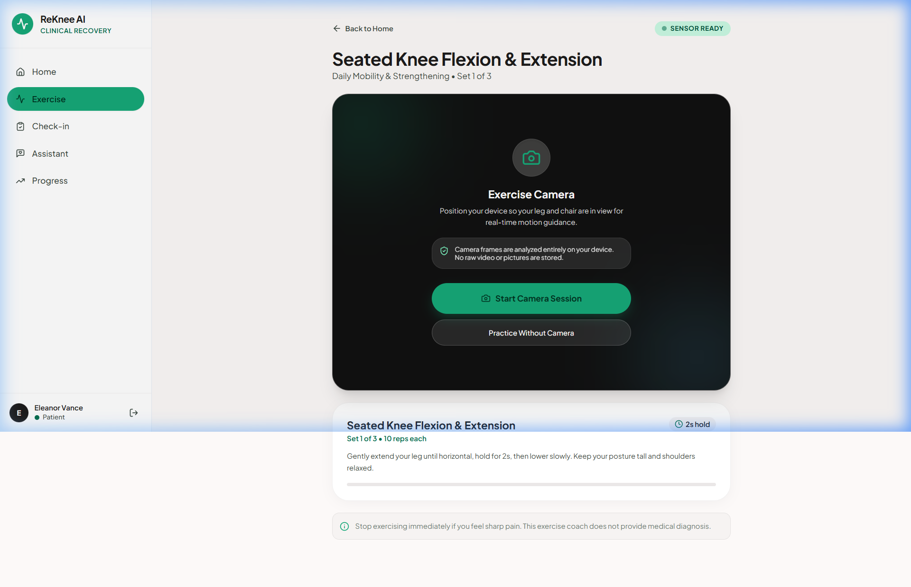
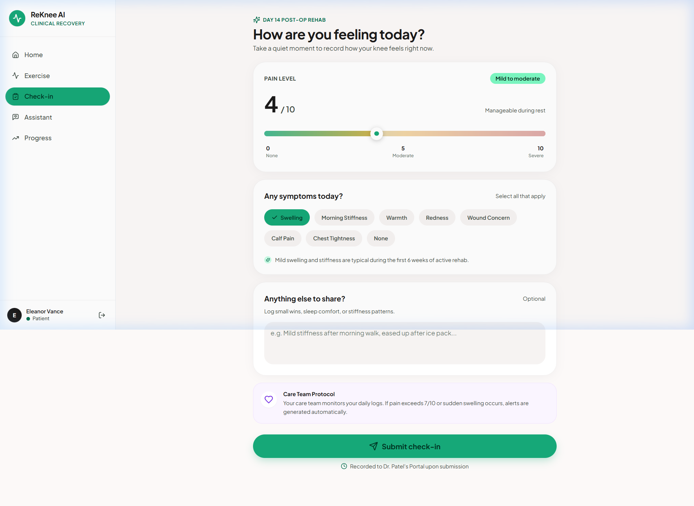
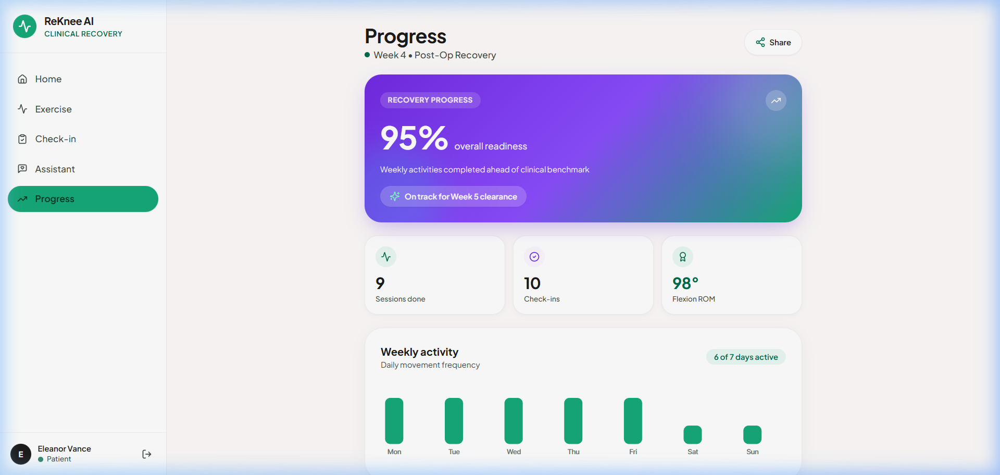
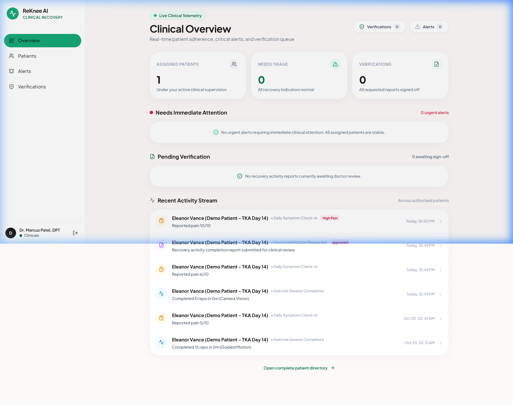

<p align="center">
  
</p>

<h1 align="center">ReKnee AI</h1>

<p align="center">
  <strong>The Connected Recovery Companion</strong>
</p>

<p align="center">
  
  
  
  
  
  
  
  
</p>

<p align="center">
  A mobile-first web application that bridges the gap between hospital discharge and follow-up visits for knee replacement patients — structured recovery guidance, camera-assisted exercise tracking, symptom monitoring, and real-time clinician oversight in one place.
</p>

---

## The Problem

After knee replacement surgery, patients are discharged into a recovery gap — weeks of uncertainty at home with limited guidance and no real-time clinician visibility:

- 🏠 **Patients** struggle to follow prescribed exercises, remember post-operative instructions, and communicate concerns between visits
- 🩺 **Clinicians** have zero visibility into recovery progress during the most critical healing window
- 📉 **Outcomes** suffer when recoveries go off-track and aren't caught until the next appointment

## The Solution

ReKnee AI turns the weeks after discharge into a **structured, connected recovery experience**:

- 📋 Approved recovery guidance in a single, clear interface
- 📸 Camera-assisted exercise sessions with real-time pose detection
- 📊 Daily symptom check-ins with structured pain and mobility tracking
- 🤖 AI assistant answering questions from a clinician-approved knowledge base
- 🚨 Configurable alerts surfaced to clinicians for timely review
- ✅ Doctor-verified recovery completion certificates

> **Note:** ReKnee AI does not diagnose, prescribe, or replace a clinician. Clinical content and thresholds are illustrative until reviewed by a qualified professional.

---

## App Screenshots

### Patient Portal

<p align="center">
  
</p>

<p align="center"><em>Recovery Home — Personalized dashboard with today's plan, progress summary, and quick actions</em></p>

<p align="center">
  
</p>

<p align="center"><em>Exercise Coach — Camera-assisted session with MediaPipe pose detection and real-time feedback</em></p>

<p align="center">
  
</p>

<p align="center"><em>Daily Check-in — Structured symptom reporting with pain scale, swelling, and mobility tracking</em></p>

<p align="center">
  
</p>

<p align="center"><em>Progress History — Visual recovery timeline with pain trends and session history</em></p>

### Clinician Portal

<p align="center">
  
</p>

<p align="center"><em>Clinical Overview — Triage dashboard with patient metrics, alert queue, and pending verifications</em></p>

---

## Features

### 🏥 Patient Portal

| Feature | What it does |
|---------|-------------|
| **Recovery Home** | Personalized dashboard — today's plan, progress rings, and quick-action cards |
| **Exercise Coach** | Camera-assisted sessions with MediaPipe pose landmark detection, rep counting, and real-time form feedback |
| **Daily Check-in** | Structured symptom reporting — pain (0–10), swelling, stiffness, mobility, and free-text notes |
| **Progress History** | Visual recovery timeline with pain trends, session history, and milestone tracking |
| **Knowledge Assistant** | Grounded Q&A from approved recovery content with source references |
| **Verified Reports** | Doctor-verified recovery completion certificates with PDF generation |

### 🩺 Clinician Portal

| Feature | What it does |
|---------|-------------|
| **Clinical Overview** | Triage dashboard — patient metrics, high-priority alert queue, pending verifications, and recent activity |
| **Patient Directory** | Searchable roster with recovery status, pain scores, and direct record access |
| **Patient Detail** | Complete record — recovery plan, exercise sessions, check-in history, pain trends, and alert timeline |
| **Alert Management** | Rule-based alert queue with acknowledge, review, and follow-up actions — fully audited |
| **Verification Review** | Review and cryptographically sign patient recovery completion reports |

---

## Tech Stack

| Layer | Technology |
|-------|-----------|
| **Frontend** | React 18 · TypeScript · Vite |
| **Styling** | Tailwind CSS · Custom Clinical Kineticism design tokens |
| **Icons** | Lucide React |
| **Charts** | Recharts |
| **Pose Detection** | MediaPipe Pose Landmarker (`@mediapipe/tasks-vision`) |
| **Backend** | Supabase (Auth + PostgreSQL + Row-Level Security) |
| **PDF Generation** | html2canvas + custom report builder |
| **Assistant** | Grounded retrieval + optional LLM synthesis |
| **Deployment** | Vercel (HTTPS required for camera access) |

---

## Architecture

```
┌──────────────────────────────────────────────────────────┐
│                        Browser                           │
├──────────────────────────────────────────────────────────┤
│  React UI (pages · components · features)                │
│  ├── MediaPipe Pose Detection (runs on-device)           │
│  ├── Grounded Knowledge Assistant                        │
│  └── PDF Report Generator                                │
├──────────────────────────────────────────────────────────┤
│  Supabase Auth · PostgreSQL + Row-Level Security         │
│  ├── Patient data isolation                              │
│  ├── Clinician-patient access relationships              │
│  └── Immutable audit trail                               │
└──────────────────────────────────────────────────────────┘
```

**Key Principles:**

- Single web application, one managed backend — no unnecessary microservices
- Row-Level Security as the final authorization boundary
- Clinician access requires an explicit `clinician_patient_access` relationship
- Camera frames stay on-device; only session metadata is persisted
- Modular feature boundaries with typed service layers

---

## Project Structure

```
src/
├── components/         # Shared UI components (layout, common)
├── pages/              # Route-level page components
├── features/           # Feature modules
│   ├── pose/           #   MediaPipe pose detection & exercise logic
│   ├── assistant/      #   Knowledge assistant service
│   ├── checkins/       #   Symptom check-in service
│   ├── alerts/         #   Alert engine & rule processing
│   └── progress/       #   Progress tracking & visualization
├── lib/                # Core libraries
│   ├── supabase/       #   Supabase client, repository, mock store
│   ├── alerts/         #   Alert rule engine
│   ├── assistant/      #   Knowledge base & retrieval
│   └── reports/        #   PDF certificate generation
├── contexts/           # React context providers (Auth)
├── types/              # TypeScript type definitions
├── App.tsx             # Router & route configuration
└── main.tsx            # Application entry point
```

---

## Getting Started

### Prerequisites

- **Node.js** 18+
- **npm** 9+

### Installation

```bash
# Clone the repository
git clone https://github.com/shreyash398/Projectphoenix_4_ReKneeAI_Batch1.git
cd Projectphoenix_4_ReKneeAI_Batch1

# Install dependencies
npm install
```

### Environment Setup

```bash
cp .env.example .env
```

**Required:**
```env
VITE_SUPABASE_URL=your_supabase_project_url
VITE_SUPABASE_ANON_KEY=your_supabase_anon_key
```

**Optional (server-only):**
```env
LLM_API_KEY=your_llm_api_key
```

> 💡 The app runs in **offline local repository mode** with synthetic data when Supabase credentials are not configured — perfect for local development and testing.

### Development

```bash
npm run dev          # Start dev server → http://localhost:5173
npm run build        # Production build (tsc + vite)
npm run preview      # Preview production build
npm run lint         # Run ESLint
npm run test         # Run test suite (185 tests)
```

---

## Routes

### Patient Portal

| Path | Page |
|------|------|
| `/` | Recovery Home |
| `/exercise` | Exercise Coach |
| `/check-in` | Daily Symptom Check-in |
| `/assistant` | Knowledge Assistant |
| `/progress` | Progress History |
| `/reports` | Verified Reports |

### Clinician Portal

| Path | Page |
|------|------|
| `/clinician` | Clinical Overview |
| `/clinician/patients` | Patient Directory |
| `/clinician/patients/:id` | Patient Detail |
| `/clinician/alerts` | Alert Queue |
| `/clinician/alerts/:id` | Alert Review |
| `/clinician/verifications` | Verification Requests |

---

## Security & Privacy

| Measure | Description |
|---------|-------------|
| **Authentication** | Supabase Auth with role-based session management |
| **Authorization** | PostgreSQL Row-Level Security as the enforcement boundary |
| **Clinician Access** | Explicit `clinician_patient_access` relationship required |
| **Data Isolation** | Patients can only access their own records |
| **Audit Trail** | All clinician actions immutably logged |
| **Camera Privacy** | Frames processed on-device via MediaPipe — no video stored or transmitted |
| **No Secrets in Frontend** | API keys and service-role credentials never exposed to the browser |

---

## Testing

Comprehensive test suite with **185 tests** across 10 test files:

- ✅ Authentication & authorization security — role enforcement, RLS boundaries, cross-patient isolation
- ✅ Clinician dashboard — metrics, patient roster, detail views, authorization
- ✅ Alert engine — rule-based generation, acknowledgement, audit trails
- ✅ Knowledge assistant — grounded retrieval, LLM fallback, rate limiting, abuse protection
- ✅ Verification reports — lifecycle workflow, approval, PDF generation, audit
- ✅ Exercise sessions — recording, pose detection integration
- ✅ Symptom check-ins — structured data capture, pain scale validation

```bash
npm run test
# ✓ 10 test files · 185 tests · all passing
```

---

## Contributors

<table>
  <tr>
    <td align="center"><strong>Shreyash Kundalkar</strong><br/>Project Lead & Full-Stack Development</td>
    <td align="center"><strong>Soham Rane</strong><br/>Frontend Development & UI/UX Design</td>
    <td align="center"><strong>Ritesh Wagh</strong><br/>Backend Development & Database Architecture</td>
    <td align="center"><strong>Sarthak Kale</strong><br/>Testing, QA & Documentation</td>
  </tr>
</table>

---

## License

This project was built as part of **Project Phoenix — Batch 1**. All rights reserved.

---

<p align="center">
  <strong>ReKnee AI</strong> — Structured recovery, connected care.
</p>
